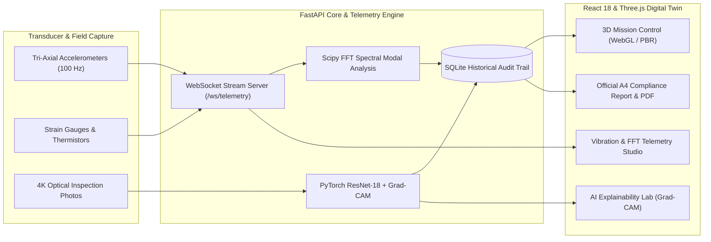

# Bridge Structural Digital Twin 🌉
### Civil Infrastructure Real-Time Structural Telemetry & Explainable AI Workstation

[](https://vercel.com/new/clone?repository-url=https%3A%2F%2Fgithub.com%2FMannPatel18%2FDIGITAL-TWIN-BACKEND-AND-3D-MONITORING-PLATFORM)
[](https://digital-twin-backend-and-3d-monitoring-platform.vercel.app)
[](https://reactjs.org/)
[](https://www.typescriptlang.org/)
[](https://threejs.org/)
[](https://tailwindcss.com/)
[](https://fastapi.tiangolo.com/)
[](https://pytorch.org/)
[](https://opensource.org/licenses/MIT)

> 🚀 **Live Interactive Demo**: [https://digital-twin-backend-and-3d-monitoring-platform.vercel.app](https://digital-twin-backend-and-3d-monitoring-platform.vercel.app)  
> *Equipped with a zero-latency standalone simulation engine: explore 3D WebGL meshes, Grad-CAM attention heatmaps, 100 Hz live FFT vibration waveforms, and export official A4 compliance PDFs directly in your browser without needing local installations.*

An enterprise-grade **Structural Health Monitoring (SHM) Digital Twin** for cable-stayed bridge infrastructure. The platform pairs interactive 3D WebGL finite-element visualization with real-time multi-channel accelerometer telemetry and deep computer-vision defect localization powered by PyTorch ResNet-18 and Grad-CAM saliency mapping.

---

## 🏛️ System Architecture



---

## 🚀 Key Workstations & Capabilities

### 1. 3D Mission Control Workstation
* **Parametric 3D Bridge Digital Twin**: Built with Three.js WebGL rendering realistic structural steel towers, graphite box girders, asphalt roadways, concrete piers, and stay-cable fan geometries.
* **Multi-Mode Visualization**:
  * **Health Heatmap**: Finite Element Analysis (FEA) color-mapping condition indices onto individual load-bearing members without washing out surrounding geometry.
  * **PBR Realistic**: Physical material shading (asphalt road slab, galvanized safety rails, mass waterline concrete).
  * **FEA Wireframe**: Structural mesh and vertex inspection mode.
* **Interactive Station Targeting**: Rapid camera transitions to *Pillar 1 Base*, *Mid-Span Deck*, and *Pillar 2 Base*.
* **Live Transducer Nodes & Defect Hotspots**: Interactive 3D pins with pulsing collision volumes; clicking any node opens the structural inspector.

### 2. AI Explainability Lab (Grad-CAM)
* **Convolutional Defect Localization**: Uses ResNet-18 backprop gradients to highlight concrete fatigue cracking, steel oxidation/spalling, or sound surfaces.
* **Side-by-Side Dual Viewport**: Compares original 4K optical field photos directly with the AI attention heatmap to audit false positives.
* **Quantitative Defect Metrics**: Measures estimated crack fissure lengths (mm), defect surface areas (cm²), and AI confidence levels.
* **Spatial 3D Raycasting**: Automatically projects 2D image detections into 3D world-coordinate vectors `[X, Y, Z]` anchored to the digital twin mesh.

### 3. Vibration & FFT Telemetry Studio
* **100 Hz Live Telemetry Stream**: Bi-directional WebSockets delivering real-time acceleration waveforms with sub-10ms latency.
* **Modal Dynamic Analysis**: Fast Fourier Transform (FFT) power spectral density graphs identifying fundamental resonant natural frequencies ($f_0$).
* **Structural Stiffness-Loss Tracking**: Automatically detects modal frequency drops ($\Delta f$) indicating flexural softening and structural fatigue.

### 4. Executive Compliance Report
* **Document-Centric Clean Design**: Contrasts dark monitoring workstations with a crisp, formal civil engineering document layout.
* **Regulatory Compliance**: Aligned with AASHTO Manual for Bridge Evaluation (MBE 3rd Ed.) and ISO 16587 vibration standards.
* **Print-Ready & PDF Export**: Client-side high-resolution 2-page A4 PDF rendering via `html2canvas` and `jsPDF`.

---

## 🛠️ Technology Stack

| Layer | Technologies |
| :--- | :--- |
| **Frontend Framework** | React 18, TypeScript, Vite |
| **3D Graphics** | Three.js, WebGL, PCF Soft Shadow Mapping |
| **Styling & Theme** | Tailwind CSS (Custom Industrial Palette) |
| **Charts & Dynamics** | Recharts, SVG Gradient Waveforms |
| **Document Generation** | jsPDF, html2canvas, CSS Print Engine |
| **Icons & UI Assets** | Lucide React |
| **Backend API** | FastAPI, Uvicorn, Python 3.10+ |
| **AI / Machine Learning**| PyTorch, Torchvision (ResNet-18), Grad-CAM Saliency |
| **Scientific Computing**| NumPy, SciPy (FFT / signal processing) |
| **Image Processing** | Pillow (PIL), NumPy |
| **Database** | SQLite3, Pydantic v2 |

---

## 📦 Quick Start Guide

### Prerequisites
* **Node.js** (v18.0 or higher) & **npm**
* **Python** (v3.10 or higher)

### 1. Clone the Repository
```bash
git clone https://github.com/MannPatel18/DIGITAL-TWIN-BACKEND-AND-3D-MONITORING-PLATFORM.git
cd DIGITAL-TWIN-BACKEND-AND-3D-MONITORING-PLATFORM
```

### 2. Set Up & Run the Backend
```bash
cd backend

# Create and activate virtual environment (optional but recommended)
python -m venv .venv
# Windows:
.venv\Scripts\activate
# Linux/macOS:
# source .venv/bin/activate

# Install Python dependencies
pip install -r requirements.txt

# Start FastAPI server on port 8000
python -m uvicorn app.main:app --host 127.0.0.1 --port 8000 --reload
```
* Backend API Documentation: `http://127.0.0.1:8000/docs`
* Telemetry WebSocket: `ws://127.0.0.1:8000/ws/telemetry`

### 3. Set Up & Run the Frontend
```bash
cd ../frontend

# Install dependencies
npm install

# Start Vite dev server on port 3000
npm run dev -- --port 3000
```
Open **`http://localhost:3000`** in your browser.

---

## 📁 Repository Structure

```
bridge-structural-digital-twin/
├── backend/
│   ├── app/
│   │   ├── ai/
│   │   │   ├── detector.py          # PyTorch inference & coordinate raycast
│   │   │   ├── explainability.py    # Grad-CAM heatmap generator
│   │   │   └── resnet_model.py      # ResNet-18 defect architecture
│   │   ├── data/
│   │   │   └── seed_data.py         # Synthetic dataset & DB seeder
│   │   ├── static/
│   │   │   └── samples/             # Benchmark test inspection images
│   │   ├── telemetry/
│   │   │   └── vibration_sim.py     # 100 Hz dynamic simulation engine
│   │   ├── database.py              # SQLite storage & schemas
│   │   └── main.py                  # FastAPI routes & WebSocket endpoint
│   └── requirements.txt
├── frontend/
│   ├── src/
│   │   ├── components/
│   │   │   ├── 3d/
│   │   │   │   ├── BridgeCanvas.tsx     # Three.js viewport & camera controls
│   │   │   │   ├── bridgeGeometry.ts   # Parametric structural meshes & materials
│   │   │   │   └── markers.ts          # 3D sensor nodes & defect markers
│   │   │   └── dashboard/
│   │   │       ├── ComplianceReport.tsx # 2-page A4 compliance report & PDF export
│   │   │       ├── ExplainabilityLab.tsx# AI Grad-CAM inspection workstation
│   │   │       └── TelemetryStudio.tsx  # Dynamic vibration & FFT charts
│   │   ├── services/
│   │   │   └── api.ts               # REST API & WebSocket client
│   │   ├── types/
│   │   │   └── index.ts             # TypeScript interfaces
│   │   ├── App.tsx                  # Application shell & navigation bar
│   │   └── index.css                # Global theme tokens & print CSS
│   ├── index.html
│   ├── package.json
│   ├── tailwind.config.js           # Industrial engineering color tokens
│   └── vite.config.ts
├── .gitignore                       # Clean git exclusion rules
└── README.md                        # Documentation
```

---

## 📜 Regulatory Standards & Compliance

* **AASHTO Manual for Bridge Evaluation (MBE)**, 3rd Edition — Component rating, condition indices, and allowable stress margins.
* **ISO 16587:2004** — Condition monitoring and diagnostics of machines & civil structures using vibration measurements.
* **FHWA Bridge Inspector's Reference Manual (BIRM)** — Non-destructive defect severity categorization.

---

## 📄 License
This project is licensed under the MIT License — see the [LICENSE](LICENSE) file for details.
